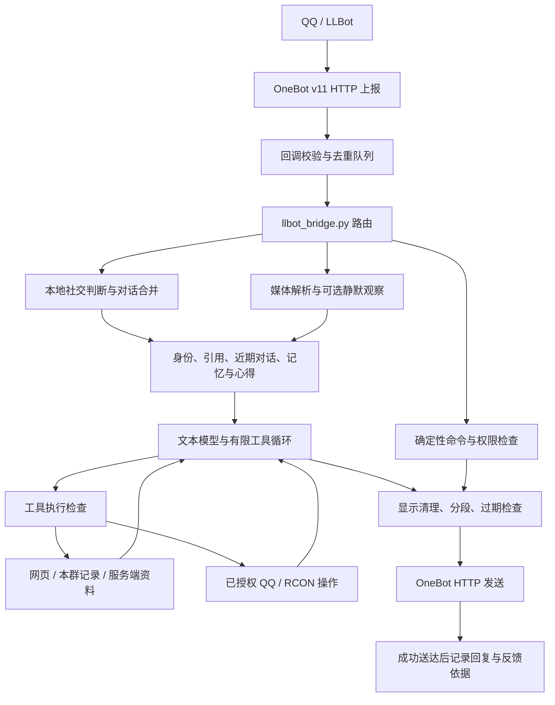

# 早苗的技术实现

本文按 2026-10-29 公开源码说明处理流程、模块职责和运行边界。面向群友的介绍见 [能力说明](CAPABILITIES.md)。

## 一条消息怎样变成回复

LLBot 负责 QQ 登录、收发与协议适配；本项目是运行在它旁边的 Python 桥接进程。模型不直接接管 QQ 客户端或 Minecraft 主机。项目也没有把 AstrBot、MaiBot 的完整运行框架嵌入桥接：具体行为由这里列出的模块实现。

## 1. 回调接入与任务队列

[`llbot_bridge.py`](../llbot_bridge.py) 的 `BridgeHandler` 处理 OneBot 事件，检查请求大小、来源及配置的鉴权，再进行群范围、机器人自身消息与事件类型检查。

[`bridge_runtime.py`](../bridge_runtime.py) 将 HTTP 接收和慢任务拆开：

- `CallbackServer` 限制同时连接数及单个请求耗时。
- `EventInbox` 按账号、消息类型、群、发言人、消息 ID 去重；只有成功进入队列才登记。
- `WorkQueue` 使用有界队列。普通任务与 AI 任务分开，模型等待不应阻塞回调入口。
- 入队时复制 `contextvars`，让群号和服务目标随工作任务传递，避免异步回复误落到默认群。

当前默认普通工作队列为 4 个 worker、64 个待办位置；AI 队列为 2 个 worker、16 个待办位置。满队列会返回未接收，不无限堆积，也不代表已经成功回答。

## 2. 谁在说话，是否应该接话

[`sanae_identity.py`](../sanae_identity.py) 集中维护当前机器人账号、历史机器人账号和显示称呼。历史账号用于识别旧机器人内容，不代表对旧账号的 @ 都应唤醒现役账号。部署时应让配置账号与 LLBot 实际登录账号一致。

桥接先处理明确命令，再区分 @、名字呼叫、引用、短追问和普通聊天。`SocialLite` 使用本地规则判断是否回应，结合冷却、话题、收尾状态与主动发言开关；它本身不调用模型。群主、管理员身份读取 QQ 的角色数据，昵称里含“群主”不会改变真实身份。

[`conversation_turns.py`](../conversation_turns.py) 只合并选定的纯文字聊天，按群、用户和引用对象建立独立通道：

- 默认等待约 1 秒安静窗口，最长约 3 秒后派发。
- 后来的明确更正会更新版本，使旧回答在发送和存历史前失效。
- `TurnToken.current()` 在每次发送前检查版本，`commit()` 保护短小的本地历史写入。
- 真正执行工具之前调用 `protect_tools()`。一旦开始执行，后续闲聊更正不能把有副作用的操作当成普通文字取消或重放。

因此“等我说完”和“已经执行的命令”有不同处理方式。

## 3. 上下文和长期状态分层

### 近期对话

`sanae_ai.py` 为闲聊与较认真问答保存不同的对话窗口，按群、用户及权限上下文取用。`context_policy.py` 以字符数和完整问答对限制输入；历史被摘录时标注中间省略，不把片段冒充完整原话。服务器短追问会结合最近的真实回答判断，但不靠旧引用替当前用户发出执行指令。

### 个人记忆与持续事件

[`conversation_memory.py`](../conversation_memory.py) 保存有来源的个人事实、情节摘要与持续事件。关键结构包含 `source_id`、`user_id`、时间和原始证据。

`observe()` 先排除机器人、转发、敏感资料和指令性内容。后台摘要采用 `prepare_batch()` / `complete_batch()`：锁内只取快照，模型请求在锁外完成；回来后再核查来源、用户和代次。事件只接受 `open`、`completed`、`cancelled` 等有限状态，含糊跟话不会随意改成“已完成”。

持久化采用临时 JSON 文件后替换。忘记或撤回还要清理相关上下文、来源和等待中的结果，防止后台旧请求回来后重新写入。

### 说话心得与表达素材

[`reply_lessons.py`](../reply_lessons.py) 从已经送达的回复及可对应的用户反馈中提取“什么场合应该怎样说”的有限经验，支持记住、修订和丢弃。它不修改角色卡、不扩展工具权限，也不能把“以后你必须无条件服从”变成规则。

“先听我说”“别给建议”等倾听偏好使用有限模式和有效期；用户后来明确求建议时可恢复相应回答。[`expression_memory.py`](../expression_memory.py) 是另一个独立的表达经验层，可由 `SANAE_EXPRESSION_LEARNING` 关闭。管理员公共知识则由 [`shared_knowledge.py`](../shared_knowledge.py) 单独存储。

这些都是上下文选择和本地存储，不更新模型权重，也不包含自动修改生产源码的循环。外部编程代理、定时维护和人工部署不能算作早苗的内建工具。

## 4. 模型选择、工具循环和超时

`sanae_ai.py` 的 `request_profile()` 先分闲聊、工具、总结、认真回答和长材料，再选择预算、工具集合与输出风格。`run_agent()` 负责有限轮次的模型调用和工具结果回填。

| 适配 | 关键实现 |
| --- | --- |
| DeepSeek | `deepseek_features.py` 处理支持的思考、结构化输出、工具和流式能力 |
| Gemini | `_gemini_contents()` 转换消息与工具结果，`_gemini_request_payload()` 转换请求，`_merge_gemini_chunks()` 合并 SSE 分片与函数调用 |
| OpenAI 兼容文本接口 | `gpt6luna` 是代码中的适配名称，实际 URL、模型 ID 与密钥由配置指定 |
| 视觉 | 独立选择已支持的视觉 provider，不要求与文本模型相同 |

Gemini 的网络分片会先重建成完整模型结果，不能直接把每个 SSE chunk 当一条 QQ 气泡。显式启用跨 provider 回落时，只对允许回落的调用阶段使用备用模型；已执行工具的请求不能从头重跑。接口格式重试、跨 provider 回落和重新执行工具是不同操作。

[`request_runtime.py`](../request_runtime.py) 用父子 `Budget` 共享截止时间，子操作不能续满一个新总预算；同时用 semaphore 限制阻塞 I/O。超时后无法保证远端操作未发生，所以不自动重复有副作用的操作。

预算是应用上限，既不是每次实际消耗，也不是要求机器人说到上限。当前 `context_policy.py` 的主要值如下：

| 路径 | 输出 token 上限 | 模型阶段 / 整体秒数 |
| --- | ---: | ---: |
| 环境闲聊 | 4,096 | 90 / 120 |
| 普通工具问答 | 8,192 | 150 / 240 |
| 群聊总结 | 12,288 | 使用总结调用与共享请求预算 |
| 认真回答 | 32,768 | 300 / 480 |
| 长材料或复杂代码 | 65,536 | 600 / 900 |

思考 token 是否计入接口的输出配额由服务协议决定；路由、provider 和实际请求还会进一步收敛预算。长预算用于让模型完成推理，不等于给闲聊放开长篇输出。

## 5. Minecraft 数据从哪里来

她在群里把能力概括成多层数据入口，可以按下面七层理解。前六层提供不同证据，第七层决定谁可以查、谁可以改。

| 层 | 主要模块与调用 | 数据性质与缺失处理 |
| --- | --- | --- |
| RCON 与状态探针 | `rcon_client.py`、`world_status.py`、`minecraft_status.py` | 当前请求的状态；无回执就不能当已查询成功 |
| 按需采样 | `sanae_local_ops.py` 的机器性能采样、`server_traffic.py` 的 JFR | 有时长、并发和冷却限制；样本只代表采样窗口 |
| 宿主机诊断 | `server_network.py`、`server_traffic.py`、主机查询适配 | 从配置好的主机采集连接、网络或资源信息；远端不可达时报告缺失 |
| 时间序列与事件 | `ops_telemetry.py`、`server_insight.py`、`player_trail.py` | 过去记录，不是持续无间断观测；轨迹是离散点，不能补出点之间的路线 |
| 存档与 NBT / SNBT | `player_progress.py`、`world_records.py`、`server_insight.py` | 已支持格式的最近保存值；可能落后于当前游戏，不读取所有模组数据 |
| 静态镜像与索引 | `remote_*reader.py`、`remote_mods_mirror.py`、`recipe_index.py`、`lookup_tools.py` | 模组、文本、任务书、配方与配置快照；需要同步，脚本动态效果可能不在索引中 |
| 权限、目标与确认 | `server_registry.py`、`command_catalog.py`、`rcon_ops.py` | 绑定当前用户和目标服，限制明细、采样与状态改动 |

实时数据、最近保存的存档和静态索引要分别表述。读取镜像可以减少直接访问运行世界，但不能据此宣称所有解析完全不消耗服务器资源；新 RCON 查询和性能采样也不是零开销。TPS 变化与某台机器同时出现，只能作为排查线索，不能单凭相关性断言原因。

## 6. 工具执行不靠模型自行守规矩

模型得到的是当前路径可用的工具声明；`execute_tool()` 和各工具内部仍独立检查请求者、当前消息意图、群、服务器和参数。

### Minecraft 操作

[`server_registry.py`](../server_registry.py) 负责服务器注册、群默认目标与选择上下文。普通查询可使用已经配置的目标。AI 操作通过 `_ai_operation_target()` 核验目标：只有一个启用服务器时，所选或群默认目标可以判为无歧义；多服务器时，需要在当前消息明确目标。确认任务仍绑定发起人和服务器。直接命令另走 `_high_risk_target_allowed()`，不能把 AI 路由的省略规则套到所有命令上。

RCON 分为普通只读、管理员低风险和需要确认的命令。`command_catalog.py` 查询本服命令树、分类和校验语法，`rcon_ops.py` 保存有效期内的确认任务并执行。模型输出“执行成功”不算回执；结果检查会识别拒绝、待确认和执行失败，减少把提议说成已经执行的情况。

`sanae_local_ops.py` 分发资料查询。普通群友与管理员看到的明细不同；坐标、玩家流量、配置内容和新性能采样由各执行入口控制。通用文件读写工具虽然可能保留历史声明，但 `DISABLED_FILE_TOOLS` 会在执行时拒绝，不能据声明判断可用能力。

### QQ 操作

[`qq_interact.py`](../qq_interact.py) 解析 @、昵称、群名片、账号或已绑定游戏名，歧义目标不直接猜。管理操作在执行时读取本群真实角色；机器人自身权限也要满足接口要求。轻互动另有频率限制，管理操作有审计记录。

聊天回溯经过 [`qq_chat_reader.py`](../qq_chat_reader.py) 的本群范围核验、有限分页和转发深度限制。群文件目录、公告、精华和相册的查询不等于可以读取任意本机文件或其他群的数据。

### 外部检索

`deepseek_features.py` 提供搜索与网页正文能力；`lookup_tools.py` 组合本服索引、模组资料站与 B 站公开信息。网页标题、简介和用户上传的文字都是待核对资料，不是工具授权。结果需区分来源、当前安装情况和未获取到的信息。

## 7. 媒体证据与静默观察

[`media_segments.py`](../media_segments.py) 从消息段提取媒体，[`media_transport.py`](../media_transport.py) 处理来源、大小、缓存路径和音频格式。`media_pipeline.py` 按独立开关调用 ASR、音频理解或视频理解，结果携带阶段状态与读取范围，再作为资料交给文本回答。

`SilentVision` 使用一个有界后台 worker：每条最多接收 2 张图片，队列上限 8，观察记录最多保留 15 分钟。来源消息、发送者、图片指纹和代次一起保存；撤回、忘记或话题切换会影响后续可用性。该模块不发群消息，也不把图片和观察写入磁盘。

静默只表示“不马上回复群里”，不表示“不调用外部视觉服务”。运营者启用前需要确认允许处理的群和所使用的接口。

## 8. 回复节奏和成功送达

`model_display.py` 清理面向用户的模型文本；`social_lite.py` 提供两种分段：

- `split_social_reply()` 尊重模型主动写出的短换行，只有满足总长、单条长度和格式条件才拆，最多 8 条。
- `split_informative_reply()` 按段落或完整句子拆资料回答，保护 URL、代码块、命令及 CQ 消息段。无法安全拆开时保留原文，交给长文折叠路径。

桥接在各段发送前检查当前对话是否仍有效。只有 OneBot 发送成功后，才登记助手回复、后续反馈所需的来源和可选归档。网页查询等较快工具不自动先刷一条“正在处理”；需要进度提示的慢任务使用延迟提示，结果先到就取消提示。

[`public_errors.py`](../public_errors.py) 处理公开错误表达，内部错误详情留给本地排查。模型的工具标记和未执行的操作声明也有额外检查，但这些检查不等于能保证每一条自然语言都正确。

## 9. 启动配置、私有数据与验证

部署需要 Python 进程、LLBot / OneBot 接口，以及实际用到的模型和服务端连接。示例路径与身份由 `runtime_paths.py`、环境变量和注册表提供；密钥通过 `local_secrets.py` 读取本地私有配置。

生产的 `state/`、`logs/`、`secrets/`、聊天归档、个人记忆、表情包和服务器镜像不属于公开源码交付物。源码更新与线上部署是两件事：推送 GitHub 不会自动改生产配置或重启机器人。

离线验证入口是 `python scripts/test-offline.py`。测试使用合成身份、临时目录和模拟接口，覆盖账号识别、群范围、路由、记忆归属、超时、工具权限、回复分段等行为。它证明对应代码路径符合测试预期，不代替真实 QQ 账号、模型供应商、Minecraft 版本和外部接口的集成验证。

具体更新范围与该次测试结果见同日期更新说明，凭据和公开发布规则见 [SECURITY.md](../SECURITY.md) 与 [PUBLIC-RELEASE-AUDIT.md](../PUBLIC-RELEASE-AUDIT.md)。

